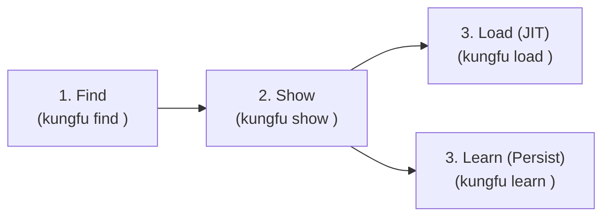

# KungFu: Agent Skills & Knowledge Gateway

`kungfu` is a high-performance CLI tool and Agent Skill gateway providing fast discovery, search, multi-skill loading, persistent learning, and execution for Agent Skills and Open Knowledge Format (OKF) bundles.

## Core Mandates & Architecture

1. **Verbatim Markdown Delivery**: Outputs clean, uncompressed markdown by default across all subcommands (`list`, `find`, `show`, `load`, `read`), keeping `--json` and `--human` as optional output formats.
2. **Just-In-Time (`load`) vs. Persistent (`learn`)**: `kungfu load` streams instructions just-in-time into agent context without disk writes, while `kungfu learn` installs and persists skills into workspace (`.agents/skills/`) or global (`~/.agents/skills/`) directories.
3. **Deterministic & Pure Go Search**: Zero-dependency pure Go search engine supporting BM25 ($k_1=1.2, b=0.75$), TF-IDF with sublinear scaling, Exact substring, and Reciprocal Rank Fusion (RRF).
4. **Ergonomic & Unambiguous Loading**: Load or learn single skills, explicit groups, entire categories, or boolean tag expressions (`AND`, `OR`, `NOT`) with clear markdown boundaries.
5. **Fuzzy "Did You Mean?" Assistance**: Automatic typo recovery, prefix matching, category/tag suggestions, and edit-distance suggestions whenever an item or command target is not found.
6. **Embedded Gateway**: Embedded self-skill (`kungfu`) and live in-memory registry access without implicit disk clutter.

---

## Agent Workflow



### Step 1: Find Matching Skills
Search the catalog using natural language keywords, category filters, or tag filters:
```bash
kungfu find "ebitengine 2d game physics"
kungfu find "go code quality refactor" --strategy hybrid --limit 5
kungfu find --category game-dev --tags "2d AND physics"
```

### Step 2: Inspect Metadata
Inspect skill description, category, tags, and companion scripts:
```bash
# Single skill
kungfu show ebitengineer

# Multiple skills
kungfu show godoctor ebitengineer

# By category or tags
kungfu show --category development
kungfu show --tags "golang AND ast"
```

### Step 3A: Load Skill Instructions (Just-In-Time)
Load verbatim markdown instructions directly into agent context without modifying disk:
```bash
# Single skill
kungfu load ebitengineer

# Group of explicit skills
kungfu load godoctor ebitengineer deslopify

# By category
kungfu load --category game-dev

# By boolean tag expression (AND / OR / NOT)
kungfu load --tags "gamedev AND ebiten"
kungfu load --tags "golang OR python"
kungfu load --tags "gamedev NOT 3d"

# Entire catalog
kungfu load --all
```

### Step 3B: Learn Skills (Persist to Disk)
Install and persist skills to canonical workspace or global locations:
```bash
# Learn to current workspace (.agents/skills/<name>)
kungfu learn godoctor
kungfu learn ebitengineer deslopify
kungfu learn --category development

# Learn globally (~/.agents/skills/<name>)
kungfu learn -g godoctor
kungfu learn -g kungfu

# Overwrite existing skill directory
kungfu learn -f godoctor
```

---

## Command Quick Reference

| Command | Usage | Description |
|---|---|---|
| `kungfu list` | `kungfu list [-c <cat>] [-t <tags>] [--all]` | List categories and discoverable items |
| `kungfu find` | `kungfu find <query> [-c <cat>] [-t <tags>] [-s <strat>]` | Search skills with pure Go BM25/TF-IDF/Hybrid |
| `kungfu show` | `kungfu show <skills...> [-c <cat>] [-t <tags>] [--all]` | Display skill metadata & overview |
| `kungfu load` | `kungfu load <skills...> [-c <cat>] [-t <tags>] [--all]` | Output verbatim markdown skill instructions (JIT) |
| `kungfu learn` | `kungfu learn <skills...> [-g] [-f] [-c <c>] [-t <t>]` | Install & persist skills into workspace or global dir |
| `kungfu run` | `kungfu run <skill> <script> [args...]` | Run bundled skill automation script |
| `kungfu read` | `kungfu read <skill> <reference>` | Read companion reference document |

### Output Modes
- **Default (Raw Markdown)**: Clean, uncompressed verbatim markdown documents separated with section headers.
- `--json`: Strict RFC 8259 JSON for structured tool integration.
- `--human`: Styled tables with headers for human terminal viewing.

### Exit Codes
- `0`: Success
- `1`: General Runtime Error
- `2`: Usage / Flag Parsing Error
- `3`: Item, Skill, or Category Not Found
- `4`: Network Error (remote registry or skill resource unreachable)
- `5`: Integrity Error (SHA-256 digest or frontmatter mismatch)
