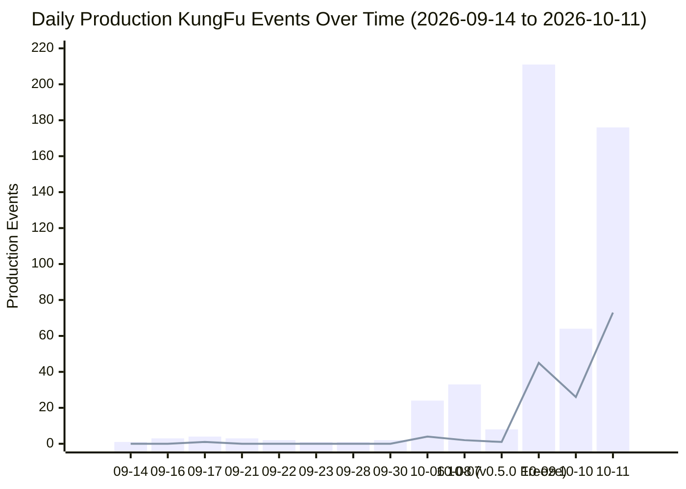

# KungFu Conversation History Data Mining, Telemetry Drift Forensics & Backfill Protocol

**Generated:** `2026-10-11T19:18:00+01:00`  
**Corpus Scope:** 100% Exhaustive (`425` union conversations across `conversation_summaries.db` and `brain/`, `76,436` steps scanned, `0` sampling)  
**Database:** [`kungfu_telemetry.db`](file:///Users/petruzalek/projects/kungfu/kungfu_telemetry.db)  
**ETL & Backfill Engine:** [`scripts/kungfu_telemetry.py`](file:///Users/petruzalek/projects/kungfu/scripts/kungfu_telemetry.py)

---

## 1. Executive Summary

An exhaustive, zero-sampling data-mining pass across all **425 conversations** (`412` with JSONL transcripts on disk, `8` early-June metadata-only conversations in `conversation_summaries.db`, and `5` scratch/empty session directories) and **76,436 trajectory steps** extracted **557 total KungFu events** (`533` production events + `24` self-test / audit-swarm events):

| Category | Production Events | Self-Test / Audit Events | Total Events | Distinct Conversations | Date Range (UTC) |
|:---|---:|---:|---:|---:|:---|
| **Direct Gateway Activation (`view_file` on `kungfu/SKILL.md`)** | **273** | 14 | **287** | 197 | `2026-09-14` $\to$ `2026-10-11` |
| **CLI Invocations (`kungfu <subcommand>`)** | **214** | 7 | **221** | 34 | `2026-09-16` $\to$ `2026-10-11` |
| **User Prompt Notations (`::skill`, `//skill`, `:?`)** | **46** | 3 | **49** | 12 | `2026-09-17` $\to$ `2026-10-11` |
| **Total Extracted KungFu Events** | **533** | **24** | **557** | **200** | **`2026-09-14` $\to$ `2026-10-11`** |

### Key Forensic Findings
1. **Why `~/.config/kungfu/state.json` Telemetry Stopped Updating on Oct 8, 2026:**
   - Every single entry in `~/.config/kungfu/state.json` `history` (`24` skills, `202` total loads) has a `last_seen_at` timestamp on or before **`2026-10-08T01:26:37.257975Z`**.
   - Exactly **18 minutes and 41 seconds later**, commit **`38cbfd1`** (`v0.5.0`, `2026-10-08T01:45:18Z`, *"feat(release): kungfu v0.5.0 - safe pagination, stateless JIT load..."*) deleted `st := a.loadState(); st.RecordLoad(target.item.Name); a.saveState(st)` from [`internal/commands/load.go`](file:///Users/petruzalek/projects/kungfu/internal/commands/load.go), leaving [`State.RecordLoad`](file:///Users/petruzalek/projects/kungfu/internal/state/state.go#L324-L339) as uncalled dead production code while [`RunStatus`](file:///Users/petruzalek/projects/kungfu/internal/commands/status.go#L206-L217) continues to render `st.History` (`Recent JIT Loads:`).
   - **94.7% (`144 / 152`)** of all production `kungfu load` CLI invocations in the transcript corpus occurred between `2026-10-09` and `2026-10-11` — **after** `state.json` froze.
2. **The "Stateless" Cache Paradox:**
   - Although `v0.5.0` removed `RecordLoad` to make `kungfu load` "stateless", [`loadItemContentWithOpts`](file:///Users/petruzalek/projects/kungfu/internal/commands/load.go#L356) still writes `~/.cache/kungfu/skills/<name>/SKILL.md` on every load. File modification timestamps in `~/.cache/kungfu/skills/` independently confirm **22 skills** were loaded via `kungfu load` after the Oct 8 freeze, including **8 cached skills completely missing from `state.json` `history`**.
3. **Gateway `view_file` Bypass (`273` Production Activations vs `19` in `state.json`):**
   - Per `<RULE[user_global]>`, agents activate `kungfu` at session start (and after context compaction) by calling `view_file` directly on `/Users/petruzalek/.gemini/config/skills/kungfu/SKILL.md` (`273` production times across `187` production conversations), bypassing the `kungfu` CLI binary entirely.
4. **Unit-Test State Pollution (`2026-10-08T01:09:28Z..01:09:36Z`):**
   - Before `38cbfd1` removed `RecordLoad` at `01:45:18Z`, running `go test ./...` at `01:09:28Z..01:09:36Z` executed `RunLoad` without isolating `KUNGFU_STATE_PATH`, injecting **4 skills with zero real transcript usage** into `~/.config/kungfu/state.json`: `pyhd` (`4`), `engineering-flow` (`2`), `evals` (`1`), and `latest-version` (`1`).
5. **Global `SKILL.md` Version Skew (`v0.4.0` vs `v0.5.0`) Causing `14` Failed Batch Loads:**
   - On `2026-10-08`, `kungfu learn -g kungfu` ran at `01:43:52Z` — **86 seconds before** commit `38cbfd1` (`01:45:18Z`) bumped `skills/kungfu/SKILL.md` to `v0.5.0`. Consequently, `/Users/petruzalek/.gemini/config/skills/kungfu/SKILL.md` is still stuck on `v0.4.0` (`6d50ac6`), instructing agents to run multi-skill batch loads (`kungfu load a b c`) that `kungfu v0.5.0` rejects with exit code `2` (`14` rejected commands across transcripts).

---

## 2. Exhaustive Extraction Breakdown (`v_subcommand_summary`)

All **557 events** in [`kungfu_telemetry.db`](file:///Users/petruzalek/projects/kungfu/kungfu_telemetry.db) are categorized by `invocation_kind`, `subcommand` / `notation_type`, production vs. self-test status, and conversation reach:

| Invocation Kind | Subcommand / Notation | Total Events | Prod (`is_self_test=0`) | Self-Test / Audit (`is_self_test=1`) | Distinct Convs | First Seen (UTC) | Last Seen (UTC) |
|:---|:---|---:|---:|---:|---:|:---|:---|
| `direct_skill_view` | `view_file` (`kungfu/SKILL.md`) | **287** | **273** | 14 | 197 | `2026-09-14T14:23:45Z` | `2026-10-11T18:02:59Z` |
| `cli_invocation` | `kungfu load` | **153** | **152** | 1 | 28 | `2026-09-17T14:22:23Z` | `2026-10-11T17:29:24Z` |
| `user_notation` | `modern_colon` (`::skill`) | **46** | **45** | 1 | 11 | `2026-10-06T12:42:35Z` | `2026-10-11T17:29:07Z` |
| `cli_invocation` | `kungfu run` | **33** | **33** | 0 | 4 | `2026-10-07T01:44:16Z` | `2026-10-10T23:22:44Z` |
| `cli_invocation` | `kungfu find` | **13** | **13** | 0 | 12 | `2026-09-17T14:22:14Z` | `2026-10-11T16:11:49Z` |
| `cli_invocation` | `kungfu show` | **8** | **8** | 0 | 5 | `2026-10-07T01:44:08Z` | `2026-10-11T17:08:55Z` |
| `cli_invocation` | `kungfu list` | **7** | **6** | 1 | 6 | `2026-10-09T11:09:46Z` | `2026-10-11T18:07:13Z` |
| `cli_invocation` | `kungfu status` | **3** | **3** | 0 | 2 | `2026-10-11T16:07:47Z` | `2026-10-11T17:18:36Z` |
| `cli_invocation` | `kungfu version` / `--version` | **2** | **1** | 1 | 2 | `2026-10-10T16:32:05Z` | `2026-10-11T17:41:57Z` |
| `user_notation` | `classic_slash` (`//skill`) | **2** | **1** | 1 | 2 | `2026-09-17T14:21:48Z` | `2026-10-11T17:29:07Z` |
| `cli_invocation` | `kungfu help` / `--help` | **1** | **1** | 0 | 1 | `2026-10-08T01:26:31Z` | `2026-10-08T01:26:31Z` |
| `cli_invocation` | `kungfu learn` (`--load`) | **1** | **1** | 0 | 1 | `2026-09-16T15:23:09Z` | `2026-09-16T15:23:09Z` |
| `user_notation` | `help_query` (`:?`) | **1** | **0** | 1 | 1 | `2026-10-11T17:29:07Z` | `2026-10-11T17:29:07Z` |
| **Total** | — | **557** | **533** | **24** | **200** | **`2026-09-14T14:23:45Z`** | **`2026-10-11T18:02:59Z`** |

---

## 3. User Prompt Notations: Classic (`//skill`) vs. Modern (`::skill` & `:?`)

### 3.1 Evolution from Classic `//skill` to Modern `::skill`
- **Classic Notation (`//<skill-name>`)**: Introduced in commit `535601c` (`2026-08-24`). Used in production once in the transcript corpus: `//google-oss` in conversation `6135811d-1597-4a77-a6c6-a96734364ff9` (step 455, `2026-09-17T14:21:48Z`), plus `1` meta-reference (`//skill-name`) in `8efbab16` step 0.
- **Modern Notation (`::<skill-name>` and `::skill(args)`)**: Introduced in commit `6d50ac6` (`2026-09-22`) and promoted to Primary Trigger #1 in commit `37670ec` (`2026-09-26`). Once adopted on `2026-10-06`, **100% of subsequent user prompt skill invocations (`45 / 45` production occurrences across `11` conversations)** used modern `::` notation.
- **Find Notation (`:?` / `::?`)**: Referenced once (`:?`) in `8efbab16-6fad-432b-84b3-f283356e4b53` step 0; in all other sessions, discovery was triggered autonomously by the agent via `kungfu find <query>` (`13` CLI executions).

### 3.2 User Notations by Target Skill
| Notation Style | Target Skill / Token | Prod Count | Total Count | Distinct Convs | Parameterized Variants Observed |
|:---|:---|---:|---:|---:|:---|
| `modern_colon` (`::`) | `::uno-reverse` | **10** | 10 | 7 | `::uno-reverse` |
| `modern_colon` (`::`) | `::parallel` | **10** | 10 | 6 | `::parallel` ($1\times$), `::parallel(10)` ($8\times$), `::parallel(10` ($1\times$) |
| `modern_colon` (`::`) | `::double-diamond` | **7** | 7 | 5 | `::double-diamond` |
| `modern_colon` (`::`) | `::deslopify` | **4** | 4 | 3 | `::deslopify` |
| `modern_colon` (`::`) | `::google-oss` | **3** | 3 | 3 | `::google-oss` |
| `modern_colon` (`::`) | `::inverted-pyramid` | **3** | 3 | 2 | `::inverted-pyramid` |
| `modern_colon` (`::`) | `::seo-optimizer` | **2** | 2 | 1 | `::seo-optimizer` |
| `modern_colon` (`::`) | `::swarm-coding` | **2** | 2 | 2 | `::swarm-coding` ($1\times$), `::swarm-coding(20)` ($1\times$) |
| `modern_colon` (`::`) | `::ebitengineer` | **1** | 1 | 1 | `::ebitengineer` |
| `modern_colon` (`::`) | `::skill-optimizer` | **1** | 1 | 1 | `::skill-optimizer` |
| `modern_colon` (`::`) | `::social-copy` | **1** | 1 | 1 | `::social-copy` |
| `modern_colon` (`::`) | `::vibe-game-developer` | **1** | 1 | 1 | `::vibe-game-developer` |
| `classic_slash` (`//`) | `//google-oss` | **1** | 1 | 1 | `//google-oss` (`2026-09-17T14:21:48Z`) |
| `modern_colon` (`::`) | `::skill-name` *(meta)* | 0 | 1 | 1 | Meta-query in `8efbab16` step 0 |
| `classic_slash` (`//`) | `//skill-name` *(meta)* | 0 | 1 | 1 | Meta-query in `8efbab16` step 0 |
| `help_query` (`:?`) | `:?` *(meta)* | 0 | 1 | 1 | Meta-query in `8efbab16` step 0 |
| **Total** | — | **46** | **49** | **12** | — |

---

## 4. Automated CLI Invocations Breakdown

### 4.1 `kungfu load` Decomposition (`153` Total CLI Calls)
Of the `153` `kungfu load` commands executed via `run_command`:
- **Primary Single-Skill Loads (`page_number = 1`, `is_subpath = 0`, `is_self_test = 0`)**: **`121`**
- **Subpath / Companion Reference Loads (`<skill>/references/...` or `assets/...`)**: **`13`**
  - `social-copy`: `5` (`references/anti_patterns.md` $\times 2$, `references/linkedin_playbook.md`, `references/twitter_playbook.md`, `references/bluesky_playbook.md`)
  - `seo-optimizer`: `3` (`references/schema_markup_guide.md`, `references/frontmatter_standards.md`, `references/google_search_genai_guidelines.md`)
  - `deslopify`: `2` (`references/tropes.md` $\times 2$)
  - `buffer`: `2` (`references/workflows.md`, `references/pitfalls.md`)
  - `swarm-coding`: `1` (`references/coordinator.md`; plus 1 batch attempt with `assets/agents/lead-agent.md`)
- **Continuation Page Loads (`-p 2` / `--page 2`)**: **`4`**
  - `skill-optimizer -p 2` ($\times 2$), `uno-reverse -p 2` ($\times 1$), `parallel -p 2` ($\times 1$)
  - *(Note: Agents also used `--full` $16\times$ and shell pipe slicing `| tail -n +...` or `| sed -n ...` $8\times$ to read beyond page 1).*
- **Rejected Multi-Skill Batch Load Attempts (`MULTI_SKILL_BATCH_REJECTED_V050`)**: **`14`**
  - Caused by `~/.gemini/config/skills/kungfu/SKILL.md` (`v0.4.0`) teaching `kungfu load a b c` while `kungfu v0.5.0` disables multi-skill `load`.
- **Self-Test / Non-Catalog Skill Load Attempts**: **`1`** (`kungfu load skill-creator`, exit code 3).

### 4.2 `kungfu run` Companion Script Executions (`33` Total Runs)
| Target Skill | Script Executed | Total Runs | Distinct Convs | First Run (UTC) | Last Run (UTC) |
|:---|:---|---:|---:|:---|:---|
| `buffer-analytics` | `scripts/buffer_sync.py` | **13** | 2 | `2026-10-09T16:04:01Z` | `2026-10-10T23:22:44Z` |
| `google-analytics` | `scripts/ga_sync.py` | **7** | 2 | `2026-10-09T16:04:19Z` | `2026-10-10T18:55:27Z` |
| `skill-optimizer` | `scripts/audit_skill.py` (`count_tokens.py`) | **7** | 2 | `2026-10-07T01:44:16Z` | `2026-10-09T14:43:39Z` |
| `search-analytics` | `scripts/gsc_sync.py` | **5** | 2 | `2026-10-09T16:04:19Z` | `2026-10-10T18:55:27Z` |
| *(help check)* | `kungfu run --help` | **1** | 1 | `2026-10-09T14:37:44Z` | `2026-10-09T14:37:44Z` |

### 4.3 `kungfu find` Discovery Queries (`13` Total Invocations)
| Timestamp (UTC) | Conv ID | Step | Search Query & Flags |
|:---|:---|---:|:---|
| `2026-09-17T14:22:14Z` | `6135811d` | 460 | `kungfu find "google-oss"` |
| `2026-10-06T12:43:08Z` | `29f5f8f8` | 62 | `kungfu find uno-reverse` |
| `2026-10-06T22:00:41Z` | `c03ec86b` | 1197 | `kungfu find swarm` |
| `2026-10-07T11:50:18Z` | `1a30533a` | 13 | `kungfu find companion` |
| `2026-10-09T11:59:29Z` | `858bcd23` | 4 | `kungfu find "golang idiomatic" --limit 5` |
| `2026-10-09T11:59:43Z` | `f072845c` | 8 | `kungfu find "golang AST"` |
| `2026-10-09T16:02:21Z` | `8a699e99` | 34 | `kungfu find "seo schema json-ld" --limit 5` |
| `2026-10-10T18:03:02Z` | `9dfa16ef` | 262 | `kungfu find "youtube video title description social copy seo"` |
| `2026-10-11T14:42:07Z` | `8db51576` | 5 | `kungfu find "code review pull request"` |
| `2026-10-11T14:42:22Z` | `8db51576` | 7 | `kungfu find "code review pull request"` |
| `2026-10-11T15:03:33Z` | `bf06e710` | 6 | `kungfu find "performance lighthouse core web vitals pagespeed"` |
| `2026-10-11T15:04:26Z` | `298a7abc` | 6 | `kungfu find "pagespeed performance lighthouse core web vitals"` |
| `2026-10-11T16:11:49Z` | `b59f8a81` | 818 | `kungfu find "presentation slides deck"` |

### 4.4 `kungfu show`, `list`, `status`, `learn`, `version`, `help` (`22` Total Invocations)
- **`kungfu show` (`8` invocations)**:
  - `2026-10-07T01:44:08Z` (`c03ec86b` step 1775): `kungfu show skill-optimizer`
  - `2026-10-09T14:38:00Z` (`e3c39e56` step 26): `kungfu show procedural-composer game-design vibe-game-developer`
  - `2026-10-09T14:38:30Z` (`e3c39e56` step 28): `kungfu show --category game-dev`
  - `2026-10-09T14:38:40Z` (`e3c39e56` step 30): `kungfu show ebitengineer procedural-art sprite-animation`
  - `2026-10-11T03:02:13Z` (`26d94653` step 328): `kungfu show godoctor`
  - `2026-10-11T16:14:14Z` (`a90d3eec` step 22): `kungfu show uno-reverse`
  - `2026-10-11T17:08:48Z` (`cce89482` step 11): `kungfu show godoctor ebitengineer swarm-coding parallel uno-reverse deslopify google-blog-style double-diamond skill-optimizer procedural-art procedural-composer kungfu`
  - `2026-10-11T17:08:55Z` (`cce89482` step 13): `kungfu show godoctor ebitengineer swarm-coding parallel`
- **`kungfu list` (`7` invocations)**: `7c26ae70` step 8, `9bc5ccaa` step 3, `20625952` steps 23 (`-c agents`) & 25, `108d0b03` step 29, `cce89482` step 5, plus 1 audit call in `f8bee1a9`.
- **`kungfu status` (`3` invocations)**: `b59f8a81` steps 800 & 818, `bf06e710` step 479 (`kungfu status pagespeed-insights`).
- **`kungfu learn` (`1` invocation)**: `6135811d` step 191 (`kungfu learn swarm-coding --load`).
- **`kungfu version` (`2` invocations)**: `9dfa16ef` step 12 (`kungfu version`), `cb44a4e5` step 42 (`kungfu --version`).
- **`kungfu --help` (`1` invocation)**: `fafd5a99` step 12 (`/Users/petruzalek/go/bin/kungfu --help`).

---

## 5. Invocations Over Time (`v_daily_invocations`)



| Date (UTC) | Total Events | Prod Events | `view_file` (`SKILL.md`) | CLI `load` | CLI `run` | CLI `find` | CLI `show`/`list`/`other` | User `//skill` | User `::skill` | Milestone / Notes |
|:---|---:|---:|---:|---:|---:|---:|---:|---:|---:|:---|
| `2026-09-14` | 1 | **1** | 1 | 0 | 0 | 0 | 0 | 0 | 0 | First `view_file` activation of `kungfu/SKILL.md` |
| `2026-09-16` | 3 | **3** | 2 | 0 | 0 | 0 | 1 (`learn --load`) | 0 | 0 | `kungfu learn swarm-coding --load` |
| `2026-09-17` | 4 | **4** | 1 | 1 | 0 | 1 | 0 | 1 (`//google-oss`) | 0 | Classic `//google-oss` triggers `find` + `load` |
| `2026-09-21` | 3 | **3** | 3 | 0 | 0 | 0 | 0 | 0 | 0 | Session-start `SKILL.md` activations |
| `2026-09-22` | 2 | **2** | 2 | 0 | 0 | 0 | 0 | 0 | 0 | `6d50ac6` adds `::skill` table to `SKILL.md` (`v0.4.0`) |
| `2026-09-23` | 1 | **1** | 1 | 0 | 0 | 0 | 0 | 0 | 0 | — |
| `2026-09-28` | 1 | **1** | 1 | 0 | 0 | 0 | 0 | 0 | 0 | — |
| `2026-09-30` | 2 | **2** | 2 | 0 | 0 | 0 | 0 | 0 | 0 | — |
| `2026-10-06` | 24 | **24** | 16 | 4 | 0 | 2 | 0 | 0 | 2 | First `::uno-reverse` & `::swarm-coding(20)` notations |
| `2026-10-07` | 33 | **33** | 26 | 2 | 2 | 1 | 1 (`show`) | 0 | 1 | First `kungfu run skill-optimizer` executions |
| **`2026-10-08`** | **8** | **8** | **6** | **1** | **0** | **0** | **1 (`help`)** | **0** | **0** | **`01:26:37Z`: Last `state.json` record; `01:45:18Z`: `v0.5.0` (`38cbfd1`) removes `RecordLoad`** |
| `2026-10-09` | 212 | **211** | 110 | 45 | 26 | 3 | 7 (`list`/`show`) | 0 | 20 | Peak day: 45 `load` & 26 `run` calls (all unrecorded in `state.json`) |
| `2026-10-10` | 64 | **64** | 25 | 26 | 5 | 1 | 1 (`version`) | 0 | 6 | 26 `load` & 5 `run` calls (all unrecorded in `state.json`) |
| `2026-10-11` | 199 | **176** | 77 | 72 | 0 | 5 | 6 (`show`/`list`/`status`) | 0 | 16 | 72 prod `load` calls + 16 `::skill` notations |
| **Total** | **557** | **533** | **273** | **152** | **33** | **13** | **16** | **1** | **45** | **94.7% (`144 / 152`) of CLI loads occurred after `state.json` froze** |

---

## 6. Cross-Reference with `~/.config/kungfu/state.json` & Root-Cause Diagnosis

### 6.1 The Six Root Causes of Telemetry Lag
1. **Root Cause 1 — The `v0.5.0` Stateless JIT Regression (`38cbfd1`, `2026-10-08T01:45:18Z`)**:
   - In [`internal/commands/load.go`](file:///Users/petruzalek/projects/kungfu/internal/commands/load.go), commit `38cbfd1` deleted lines 183–185 (`st := a.loadState(); st.RecordLoad(target.item.Name); a.saveState(st)`).
   - Meanwhile, [`internal/state/state.go:324`](file:///Users/petruzalek/projects/kungfu/internal/state/state.go#L324) still defines `func (s *State) RecordLoad(skillName string)` and [`internal/commands/status.go:206`](file:///Users/petruzalek/projects/kungfu/internal/commands/status.go#L206) still displays `Recent JIT Loads:` from `st.History`.
   - Because `RecordLoad` is never called anywhere in `internal/commands/`, `state.json` `history` has been completely frozen since `2026-10-08T01:26:37.257975Z`.
2. **Root Cause 2 — Direct `view_file` Gateway Bypass (`273` Production Reads)**:
   - Agents activate the `kungfu` skill at the start of every session by calling `view_file` on `/Users/petruzalek/.gemini/config/skills/kungfu/SKILL.md` (`273` production times), which never invokes the `kungfu` CLI binary.
3. **Root Cause 3 — Pre-`v0.5.0` Unit-Test State Pollution (`2026-10-08T01:09:28Z..01:09:36Z`)**:
   - Just before `v0.5.0` removed `RecordLoad`, unit tests in `internal/commands/commands_test.go` and `load_run_test.go` ran `App.RunLoad` without setting a temporary `KUNGFU_STATE_PATH`. This polluted the real `~/.config/kungfu/state.json` with `pyhd` (`4`), `engineering-flow` (`2`), `evals` (`1`), and `latest-version` (`1`), and added `+1` test load to `godoctor` at `01:09:36Z`.
4. **Root Cause 4 — Untracked Subcommands (`learn --load`, `run`, `find`, `show`, `list`)**:
   - `kungfu learn <skill> --load` (`-l`) in [`internal/commands/learn.go:241`](file:///Users/petruzalek/projects/kungfu/internal/commands/learn.go#L241) streams `SKILL.md` into context identically to `kungfu load`, but only calls `st.RecordInstall` and never `st.RecordLoad`.
   - `kungfu run` (`33` executions), `kungfu find` (`13`), `kungfu show` (`8`), and `kungfu list` (`7`) have zero telemetry instrumentation in `state.json`.
5. **Root Cause 5 — Pagination (`-p 2`) & Subpath (`skill/references/...`) Distortion + Unlocked Concurrent Writes**:
   - Before `v0.5.0`, `load.go` incremented `load_count` on every `kungfu load <skill>/<subpath>` reference file read (inflating `developing-genkit-go` to `75` loads across its 15 reference files).
   - If `RecordLoad` were naively restored in `v0.5.0` without checking `pageFlag == 1 && target.subpath == ""`, paginating a 3-page skill (`-p 1`, `-p 2`, `-p 3`) would triple-count a single logical skill load.
   - Furthermore, `state.SaveState` uses an in-process `sync.RWMutex` without OS-level `syscall.Flock`, risking lost updates when `::parallel(10` subagents run `kungfu load` concurrently.
6. **Root Cause 6 — Global `SKILL.md` Version Skew (`v0.4.0` vs `v0.5.0`) & Stale `skills/catalog.json` Digest**:
   - `~/.gemini/config/skills/kungfu/SKILL.md` (`-> ~/.agents/skills/kungfu/SKILL.md`) was installed at `2026-10-08T01:43:52Z`, 86 seconds before commit `38cbfd1` (`01:45:18Z`), leaving it at `v0.4.0` and causing agents to attempt disabled multi-skill batch loads (`14` failures).
   - [`skills/catalog.json:30-31`](file:///Users/petruzalek/projects/kungfu/skills/catalog.json#L30-L31) has a stale SHA-256 (`9a782101...`) that does not match `skills/kungfu/SKILL.md` (`12fb33cb...`).

### 6.2 Skill-by-Skill Drift Matrix (`v_skill_telemetry_drift`)
| Skill Name | `state.json` Count | `state.json` Last Seen (UTC) | Transcript CLI Raw Loads | Transcript CLI Primary Loads (`p=1`, no subpath) | Direct `view_file` | User Notations | CLI `run` | Total Transcript Activations | Drift vs `state.json` | Backfill Target Count | Forensic Diagnosis |
|:---|---:|:---|---:|---:|---:|---:|---:|---:|---:|---:|:---|
| `kungfu` | 19 | `2026-10-08T01:26:37Z` | 1 | 1 | **273** | 0 | 0 | **274** | **+255** | **274** | `DIRECT_VIEW_BYPASS_AND_V050_STATELESS_FREEZE` |
| `uno-reverse` | 22 | `2026-10-08T01:10:43Z` | 24 | 23 | 0 | 10 | 0 | **23** | **+1** | **23** | `POST_V050_LOADS_FROZEN_IN_STATE_JSON` |
| `buffer` | 4 | `2026-09-25T12:39:35Z` | 13 | 11 | 0 | 0 | 0 | **11** | **+7** | **11** | `POST_V050_LOADS_FROZEN_IN_STATE_JSON` |
| `skill-optimizer` | 4 | `2026-10-07T01:44:30Z` | 13 | 11 | 0 | 1 | 7 | **11** | **+7** | **11** | `POST_V050_LOADS_FROZEN_IN_STATE_JSON` |
| `parallel` | 12 | `2026-10-08T01:07:06Z` | 11 | 10 | 0 | 10 | 0 | **10** | **-2** | **12** | `PRE_V050_SUBPATH_COUNT_AND_POST_V050_FROZEN` |
| `double-diamond` | 1 | `2026-09-25T22:30:20Z` | 10 | 10 | 0 | 7 | 0 | **10** | **+9** | **10** | `POST_V050_LOADS_FROZEN_IN_STATE_JSON` |
| `social-copy` | 5 | `2026-09-23T11:51:36Z` | 14 | 9 | 0 | 1 | 0 | **9** | **+4** | **9** | `POST_V050_LOADS_FROZEN_IN_STATE_JSON` |
| `google-oss` | 10 | `2026-10-08T01:01:08Z` | 6 | 6 | 0 | 4 | 0 | **6** | **-4** | **10** | `PRE_V050_SUBPATH_COUNT_AND_POST_V050_FROZEN` |
| `buffer-analytics` | 1 | `2026-09-18T13:45:37Z` | 6 | 6 | 0 | 0 | 13 | **6** | **+5** | **6** | `POST_V050_LOADS_FROZEN_IN_STATE_JSON` |
| `google-analytics` | 1 | `2026-09-18T13:45:51Z` | 6 | 6 | 0 | 0 | 7 | **6** | **+5** | **6** | `POST_V050_LOADS_FROZEN_IN_STATE_JSON` |
| `search-analytics` | 1 | `2026-09-18T13:45:45Z` | 6 | 6 | 0 | 0 | 5 | **6** | **+5** | **6** | `POST_V050_LOADS_FROZEN_IN_STATE_JSON` |
| `deslopify` | 1 | `2026-09-21T15:58:02Z` | 7 | 5 | 0 | 4 | 0 | **5** | **+4** | **5** | `POST_V050_LOADS_FROZEN_IN_STATE_JSON` |
| `seo-optimizer` | **0** | *(never recorded)* | 8 | 5 | 0 | 2 | 0 | **5** | **+5** | **5** | `POST_V050_STATELESS_LOAD_UNRECORDED` |
| `inverted-pyramid` | 2 | `2026-09-26T16:26:07Z` | 4 | 4 | 0 | 3 | 0 | **4** | **+2** | **4** | `POST_V050_LOADS_FROZEN_IN_STATE_JSON` |
| `swarm-coding` | 11 | `2026-10-06T22:01:11Z` | 4 | 2 (+1 `learn -l`) | 0 | 2 | 0 | **3** | **-8** | **11** | `PRE_V050_SUBPATH_COUNT_AND_POST_V050_FROZEN` |
| `ebitengineer` | **0** | *(never recorded)* | 2 | 2 | 0 | 1 | 0 | **2** | **+2** | **2** | `POST_V050_STATELESS_LOAD_UNRECORDED` |
| `go` | **0** | *(never recorded)* | 2 | 2 | 0 | 0 | 0 | **2** | **+2** | **2** | `POST_V050_STATELESS_LOAD_UNRECORDED` |
| `google-blog-style` | **0** | *(never recorded)* | 1 | 1 | 0 | 0 | 0 | **1** | **+1** | **1** | `POST_V050_STATELESS_LOAD_UNRECORDED` |
| `developing-genkit-go` | 75 | `2026-10-05T11:45:52Z` | 0 | 0 | 0 | 0 | 0 | **0** | **-75** | **75** | `PRE_V050_EXTERNAL_OR_SUBPATH_HISTORICAL` |
| `ag-ui-a2ui-integration` | 10 | `2026-10-08T01:21:16Z` | 0 | 0 | 0 | 0 | 0 | **0** | **-10** | **10** | `PRE_V050_EXTERNAL_OR_SUBPATH_HISTORICAL` |
| `godoctor` | 6 | `2026-10-02T06:15:03Z` | 0 | 0 | 0 | 0 | 0 | **0** | **-6** | **6** | `PRE_V050_EXTERNAL_OR_SUBPATH_HISTORICAL` |
| `nano-banana` | 6 | `2026-10-06T12:49:35Z` | 0 | 0 | 0 | 0 | 0 | **0** | **-6** | **6** | `PRE_V050_EXTERNAL_OR_SUBPATH_HISTORICAL` |
| `gemini-api-dev` | 2 | `2026-10-02T16:13:14Z` | 0 | 0 | 0 | 0 | 0 | **0** | **-2** | **2** | `PRE_V050_EXTERNAL_OR_SUBPATH_HISTORICAL` |
| `developing-genkit-js` | 1 | `2026-09-27T04:59:33Z` | 0 | 0 | 0 | 0 | 0 | **0** | **-1** | **1** | `PRE_V050_EXTERNAL_OR_SUBPATH_HISTORICAL` |
| `pyhd` | 4 | `2026-10-08T01:09:36Z` | 0 | 0 | 0 | 0 | 0 | **0** | **-4** | **0 (purge)** | `PRE_V050_UNIT_TEST_POLLUTION` |
| `engineering-flow` | 2 | `2026-10-08T01:09:36Z` | 0 | 0 | 0 | 0 | 0 | **0** | **-2** | **0 (purge)** | `PRE_V050_UNIT_TEST_POLLUTION` |
| `evals` | 1 | `2026-10-08T01:09:30Z` | 0 | 0 | 0 | 0 | 0 | **0** | **-1** | **0 (purge)** | `PRE_V050_UNIT_TEST_POLLUTION` |
| `latest-version` | 1 | `2026-10-08T01:09:28Z` | 0 | 0 | 0 | 0 | 0 | **0** | **-1** | **0 (purge)** | `PRE_V050_UNIT_TEST_POLLUTION` |

---

## 7. Proposed Fix & Backfill Protocol

### 7.1 Go Architecture Fix (When Ready to Apply to `kungfu`)
1. **Cross-Process Exclusive File Locking (`internal/state/state.go`)**:
   - Add `WithLockedState(filePath string, fn func(s *State) error) error` using `syscall.Flock(int(lockFile.Fd()), syscall.LOCK_EX)` on `state.json.lock` so concurrent `::parallel(10` subagents never clobber `state.json` via Last-Writer-Wins races.
   - Decouple lightweight telemetry updates (`WithLockedState`) from the heavy full-disk `ReconcileDisk` SHA-256 walk so `kungfu load` records telemetry in $<1\text{ ms}$ without scanning `.agents/skills/`.
2. **Pagination- & Subpath-Aware `RecordLoadDetailed` (`internal/state/state.go` & `internal/commands/load.go`)**:
   - Extend `HistoryRecord` with `PageLoadCount`, `SubpathLoadCount`, and `RunCount`:
     ```go
     type HistoryRecord struct {
         LastSeenAt       time.Time `json:"last_seen_at"`
         LoadCount        int       `json:"load_count"`
         PageLoadCount    int       `json:"page_load_count,omitempty"`
         SubpathLoadCount int       `json:"subpath_load_count,omitempty"`
         RunCount         int       `json:"run_count,omitempty"`
     }
     ```
   - In [`internal/commands/load.go`](file:///Users/petruzalek/projects/kungfu/internal/commands/load.go), invoke `s.RecordLoadDetailed(target.item.Name, target.subpath, pageFlag)`:
     - Increment `LoadCount` **only** when `target.subpath == "" && pageFlag == 1`.
     - Increment `PageLoadCount` when `target.subpath == "" && pageFlag > 1`.
     - Increment `SubpathLoadCount` when `target.subpath != ""`.
3. **Instrument `learn --load` and `run` (`internal/commands/learn.go`, `internal/commands/run.go`)**:
   - In `RunLearn`, when `loadFlag` (`--load` / `-l`) is true, also call `st.RecordLoadDetailed(item.Name, "", 1)`.
   - In `RunRun`, call `s.RecordRun(item.Name)` inside `state.WithLockedState`.
4. **Isolate Unit Tests from Global `~/.config/kungfu/state.json`**:
   - Ensure `TestMain` / test helpers in `internal/commands/*_test.go` set `t.Setenv("KUNGFU_STATE_PATH", filepath.Join(t.TempDir(), "state.json"))` so `go test ./...` never mutates the user's live `~/.config/kungfu/state.json`.
5. **Sync Global `SKILL.md` to `v0.5.0` & Fix `skills/catalog.json` Digest**:
   - Update [`skills/catalog.json:30-31`](file:///Users/petruzalek/projects/kungfu/skills/catalog.json#L30-L31) digest to `sha256:12fb33cb9e0ad6b6fcc2da83eb13424cf421591ce18f202c966257a2636c76c4` and run `kungfu learn -g -f kungfu` so agents stop issuing `v0.4.0` multi-skill batch loads.

### 7.2 Operating the SQLite ETL & Backfill Script ([`scripts/kungfu_telemetry.py`](file:///Users/petruzalek/projects/kungfu/scripts/kungfu_telemetry.py))

```bash
# 1. Incremental update (default: fast <150ms watermark check across all transcripts)
python3 scripts/kungfu_telemetry.py --mode incremental

# 2. Full rebuild from scratch (drops & recreates tables/views in kungfu_telemetry.db)
python3 scripts/kungfu_telemetry.py --mode rebuild

# 3. Print full summary report (or --json for programmatic consumption)
python3 scripts/kungfu_telemetry.py --mode summary

# 4. Preview state.json backfill plan (dry-run default)
python3 scripts/kungfu_telemetry.py --mode backfill-state --dry-run

# 5. Apply atomic backfill to ~/.config/kungfu/state.json (202 -> 508 reconciled loads, purges unit-test pollution)
python3 scripts/kungfu_telemetry.py --mode backfill-state --apply
```
