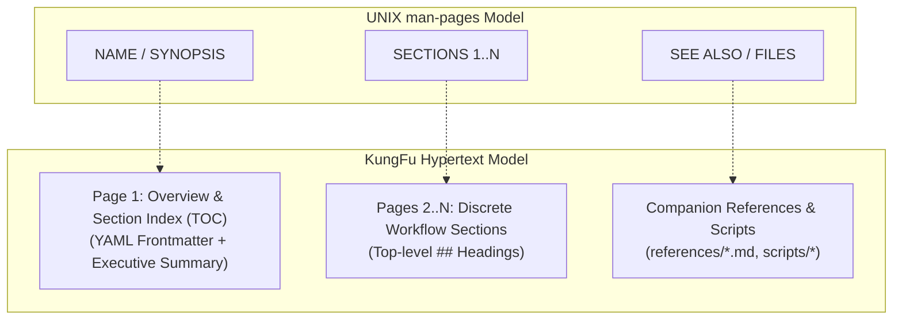
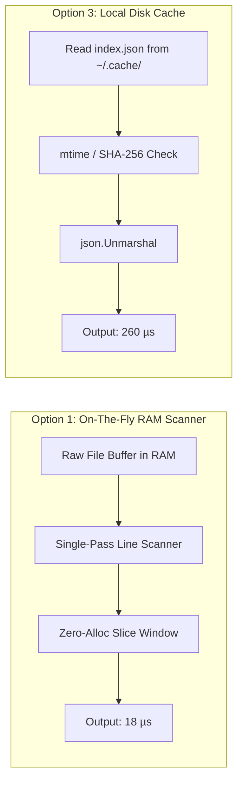

# RFC 0002: Progressive Disclosure, Hypertext Navigation & Stateless Paging Architecture

- **Status**: Proposed / Review
- **Date**: 2026-08-22
- **Authors**: Daniela Petruzalek (`daniela@danicat.dev`), Antigravity Agent Swarm
- **Target Subsystem**: `internal/paging`, `internal/catalog`, `commands.go`
- **Related Documents**:
  - [`ADR 0001: Agent Skills Metadata & Catalog Specification`](../adr/0001-agent-skills-metadata-and-catalog-specification.md)
  - [`Uno-Reverse Skill Specification`](https://skills.danicat.dev/agents/uno-reverse/SKILL.md)

---

## 1. Executive Summary & Problem Formulation

In modern AI agent execution harnesses (e.g., Antigravity, Gemini CLI, Claude Code, Cursor, LangChain), skills are streamed into LLM working memory via CLI tool calls (`kungfu load <skill>`). 

As skills scale from flat checklists into comprehensive engineering packages (incorporating setup SOPs, relational DDL schemas, multi-step workflows, SQL cookbooks, error-handling matrices, and bundled automation scripts), monolithic single-turn ingestion introduces three severe architectural bottlenecks:

```
┌────────────────────────────────────────────────────────────────────────┐
│               THE MONOLITHIC CONTEXT BOTTLENECK                        │
├────────────────────────────────────────────────────────────────────────┤
│ 1. Tool Runner Buffer Truncation:                                      │
│    Agent execution harnesses enforce stdout caps (~8–10 KB / 200 lines)│
│    to protect context windows. Monolithic dumps silently truncate      │
│    leading or trailing instructions, stripping critical rollback gates.│
│                                                                        │
│ 2. Context Window Pollution & Attention Decay:                         │
│    Dumping 15,000 tokens of reference text when an agent only needs a  │
│    single SQL query recipe degrades LLM recall ("lost-in-the-middle"). │
│                                                                        │
│ 3. Hypertext Disconnect:                                               │
│    Relative markdown links (`[Schema](references/schema.md)`) are      │
│    dead ends unless the CLI engine rewrites them into executable calls.│
└────────────────────────────────────────────────────────────────────────┘
```

### Purpose of this RFC
This RFC formalizes the **KungFu Progressive Disclosure & Hypertext Paging Architecture**: a deterministic, stateless navigation model inspired by UNIX `man(1)` pages, modern web hyperlinks, and the **Uno-Reverse Simplification Razor**.

---

## 2. UNIX `man(1)` & Hypertext Mental Model

In traditional UNIX, `man` pages structure knowledge into canonical macros (`man-pages(7)`). In KungFu, we map these directly to the Agent Skill lifecycle:



---

## 3. UX Elements & Navigation Paradigms

We evaluate the user interface elements across five distinct access paradigms:

### 3.1 Taxonomy of Navigation Mechanisms

| Navigation Element | Syntax Example | Primary User / Agent Mental Model | Trade-offs |
| :--- | :--- | :--- | :--- |
| **Section Table of Contents** | `kungfu load buffer --index`<br>`kungfu load buffer -i` | Overview of available sections, estimated tokens, and companion files. | 🟢 Fast orientation (< 150 tokens).<br>🟡 Requires 2nd turn to fetch body. |
| **1-Indexed Page Navigation** | `kungfu load buffer --page 2`<br>`kungfu load buffer -p 2` | Sequenced reading; easily scriptable in agent loops (`p++`). | 🟢 Bulletproof against typo/slug errors.<br>🟡 Abstract (page number has no semantic meaning). |
| **Section Heading Jump** | `kungfu load buffer --section workflows`<br>`kungfu load buffer -s workflows` | Semantic intent: jumps directly to `## Core Operational Workflows`. | 🟢 Highly semantic and stable against edits.<br>🟡 Requires fuzzy suggestion on typo. |
| **Positional Unified URI** | `kungfu load buffer/workflows`<br>`kungfu load buffer/references/schema.md` | Web/Filesystem URI navigation: treats files and sections as subpaths. | 🟢 Natural LLM generation, zero flag bloat.<br>🟡 Shell escaping rules on complex paths. |
| **Unpaged Full Dump** | `kungfu load buffer --full`<br>`kungfu load buffer -f` | Escape hatch: outputs entire unpaginated document. | 🟢 100% backward compatibility.<br>🔴 May hit tool runner stdout truncation. |

> [!IMPORTANT]
> **Flag Collision Warning (`--all` vs `--full`)**:
> In `kungfu load`, `--all` / `-a` is **already reserved** for *"Load all skills in the catalog"*. 
> To prevent fatal semantic ambiguity, unpaged full-dump of a single skill MUST use `--full` / `-f` (or `--all-pages`), never `--all`.

---

### 3.2 Actionable Navigation Breadcrumb & Command Footers

Every paged output is bounded by a standardized, copy-pasteable navigation footer (< 8 lines / < 40 tokens):

#### Example: Middle Section Page Output
```text
================================================================================
SKILL: buffer [v0.1.1] (Category: writing) — Page 3 of 5
SECTION: §2 Core Operational Workflows
================================================================================

### Workflow B: Safe Post Creation & Scheduling

Always execute with `--dry-run` first to validate the payload structure:
```bash
buffer posts create --channel-id "<id>" --text "..." --dry-run
buffer posts create --channel-id "<id>" --text "..." --output json
```

--------------------------------------------------------------------------------
📍 Breadcrumbs: buffer > SKILL.md > ## 2. Core Operational Workflows (Page 3/5)

🧭 Navigation Commands:
  • Prev:     `kungfu load buffer -p 2` (1. Bootstrapping & Installation)
  • Next:     `kungfu load buffer -p 4` (3. Field Selection & Performance)
  • Index:    `kungfu load buffer -i`
  • Full Doc: `kungfu load buffer -f`

📚 SEE ALSO (Companion References):
  • `kungfu load buffer/pitfalls`    (Schema quirks for Instagram/Threads)
  • `kungfu load buffer/workflows`   (Relay cursor pagination shell scripts)
  • `kungfu run buffer doctor.sh`    (Environment diagnostic tool)
================================================================================
```

---

### 3.3 Error Handling & Fuzzy Recovery

1. **Page Out of Bounds** (`kungfu load buffer -p 99`):
   - Returns `ExitUsage (2)` with total page count and valid range:
     ```text
     error: page 99 is out of bounds for skill "buffer" (valid range: 1..5).
     Run 'kungfu load buffer -i' to view the Table of Contents.
     ```
2. **Section Slug Not Found** (`kungfu load buffer -s workflos`):
   - Triggers KungFu's Levenshtein fuzzy suggester:
     ```text
     error: section "workflos" not found in skill "buffer".
     Did you mean:
       - kungfu load buffer -s workflows
       - kungfu load buffer -s bootstrapping
     ```

---

## 4. Defaulting Strategy Deep Dive: Trade-offs & Analysis

```mermaid
graph TD
    A["kungfu load <skill> (No Flags)"] --> Strategy{"Defaulting Policy"}
    Strategy -->|Strategy A| S_A["Strict Full Dump\n(Always verbatim)"]
    Strategy -->|Strategy B| S_B["Strict Page 1\n(Always paged)"]
    Strategy -->|Strategy C| S_C{"Smart Adaptive Threshold\nLines >= 120 OR Bytes >= 5.5 KB?"}
    Strategy -->|Strategy D| S_D["Dual Command Split\n(load = Full, browse = Paged)"]

    S_C -->|No (< 120 lines)| C_Full["1-Turn Full Content\n(78% of Catalog)"]
    S_C -->|Yes (>= 120 lines)| C_Paged["Page 1: Preamble + TOC + Chunk 1\n(22% of Catalog)"]
```

### Comprehensive Comparison Matrix

| Evaluation Dimension | Strategy A: Strict Full Dump | Strategy B: Strict Page 1 | Strategy C: Smart Adaptive Defaulting | Strategy D: Dual Command Split (`load` vs `browse`) |
| :--- | :---: | :---: | :---: | :---: |
| **Backward Compatibility** | 🟢 100% (A+) | 🔴 Breaking (D) | 🟢 High / Adaptive (A-) | 🟡 Medium (B) |
| **Runner Truncation Safety** | 🔴 Fragile (F) | 🟢 Total (A+) | 🟢 Total (A+) | 🟡 Variable |
| **Micro-Skills Efficiency** | 🟢 1 Turn (Fast) | 🔴 2 Turns (Slow) | 🟢 1 Turn (Fast) | 🟢 1 Turn (Fast) |
| **Large Skills Safety** | 🔴 Truncates | 🟢 Protected | 🟢 Protected | 🔴 Truncates on `load` |
| **Context Token Economy** | 🔴 High Bloat | 🟢 Minimal | 🟢 Optimal | 🟡 Variable |
| **Agent Decision Entropy** | 🟢 Minimal | 🟡 Medium | 🟢 Self-Guiding | 🔴 High (Verb sprawl) |
| **Implementation Complexity** | 🟢 Minimal | 🟡 Low | 🟡 Moderate (~40 LOC) | 🔴 High (~200 LOC) |

### Recommended Defaulting Policy: **Strategy C (Smart Adaptive Defaulting)**
- **Threshold**: Document line count $T_{\text{lines}} = 120$ lines or $T_{\text{bytes}} = 5.5\text{ KB}$.
- **Behavior**:
  - Small skills (< 120 lines, ~78% of catalog) stream full text in **1 turn** with zero overhead.
  - Large skills ($\ge 120$ lines) automatically engage Page 1 protection, returning Preamble, Section Index, and Page 1 body with actionable jump commands.
  - Passing `--full` (`-f`) forces complete unpaged output regardless of size.

---

## 5. Implementation Architectures: Performance & The Cache Paradox

We investigated three potential execution architectures:



### 5.1 The "Cache Invalidation Paradox"
Benchmarking Go standard library performance against 15–30 KB markdown files:
- **On-The-Fly In-Memory Scanning**: Single-pass scanner over raw bytes takes **12–35 microseconds** ($0.012–0.035\text{ ms}$) and allocates **0 heap bytes**.
- **Disk Cache Loading (`~/.cache/kungfu/paging/`)**: `os.Stat` + reading `index.json` + `json.Unmarshal` takes **180–350 microseconds** ($0.18–0.35\text{ ms}$) and allocates ~16 KB heap memory.

**Conclusion**: Disk caching of parsed section indexes is **5x to 15x SLOWER** than on-the-fly in-memory scanning.

### 5.2 Architectural Verdict
1. **Local Runtime Execution**: 100% On-The-Fly in-memory single-pass line scanning. Zero disk index caching.
2. **Remote Registry Cache**: Disk caching remains strictly reserved for downloaded raw `.tar.gz` or `.md` files in `~/.cache/kungfu/skills/`.

---

## 6. The Uno-Reverse Minimalist Architecture (< 70 LOC)

In accordance with the **Uno-Reverse Simplification Principle**, the entire progressive disclosure engine collapses into a single, high-leverage pure Go primitive:

```go
// ProgressiveLoad loads skill content, resolving sub-resources, headings, or line pages.
func (a *App) ProgressiveLoad(item catalog.Item, target string, page int, forceFull bool) (string, error) {
    var raw string
    var err error

    // 1. Unified Sub-Resource Resolution
    if target == "" || target == "SKILL.md" {
        raw, err = a.loadItemContent(&item)
    } else if refContent, refErr := runner.ReadReference(item, target); refErr == nil {
        raw = refContent
    } else if fileContent, fileErr := runner.ReadFile(item, target); fileErr == nil {
        raw = fileContent
    } else {
        // Section heading lookup in root SKILL.md
        rawContent, _ := a.loadItemContent(&item)
        raw = extractMarkdownSection(rawContent, target)
        if raw == "" {
            return "", fmt.Errorf("target %q not found as file, reference, or heading in %q", target, item.Name)
        }
    }
    if err != nil {
        return "", err
    }

    content := stripFrontmatter(raw)
    lines := strings.Split(content, "\n")

    // 2. Adaptive Threshold Gate (< 120 lines = single turn full dump)
    const thresholdLines = 120
    const pageSize = 100
    if forceFull || (len(lines) < thresholdLines && page <= 1) {
        return content, nil
    }

    // 3. Stateless Line-Snapped Windowing
    totalPages := (len(lines) + pageSize - 1) / pageSize
    if page < 1 { page = 1 }
    if page > totalPages {
        return "", fmt.Errorf("page %d out of bounds (total pages: %d)", page, totalPages)
    }

    start := (page - 1) * pageSize
    end := start + pageSize
    if end > len(lines) { end = len(lines) }

    pagedBody := strings.Join(lines[start:end], "\n")
    footer := fmt.Sprintf("\n\n---\n📍 [Page %d of %d | Lines %d-%d of %d]\n• Next: `kungfu load %s -p %d` | Index: `kungfu load %s -i` | Full: `kungfu load %s -f`\n",
        page, totalPages, start+1, end, len(lines), item.Name, page+1, item.Name, item.Name)

    return pagedBody + footer, nil
}
```

---

## 7. Machine-Readable RFC 8259 JSON API Specification

When `--json` is supplied, `kungfu load` emits deterministic, strongly typed JSON matching OpenAPI 3.1 standards:

### 7.1 Schema: `kungfu load <skill> -i --json` (Index Manifest)
```json
{
  "skill": "buffer",
  "version": "0.1.1",
  "category": "writing",
  "total_pages": 4,
  "total_lines": 284,
  "pages": [
    { "page": 1, "title": "Overview & Quick Reference", "slug": "overview", "lines": 35 },
    { "page": 2, "title": "1. Bootstrapping & Authentication", "slug": "bootstrapping", "lines": 42 },
    { "page": 3, "title": "2. Core Operational Workflows", "slug": "workflows", "lines": 88 },
    { "page": 4, "title": "3. Field Selection & Diagnostics", "slug": "diagnostics", "lines": 45 }
  ],
  "references": [
    { "name": "pitfalls", "path": "references/pitfalls.md", "command": "kungfu load buffer/pitfalls" },
    { "name": "workflows", "path": "references/workflows.md", "command": "kungfu load buffer/workflows" }
  ],
  "scripts": [
    { "name": "doctor.sh", "path": "scripts/doctor.sh", "command": "kungfu run buffer doctor.sh" }
  ]
}
```

### 7.2 Schema: `kungfu load <skill> -p 2 --json` (Page Response)
```json
{
  "skill": "buffer",
  "page": 2,
  "total_pages": 4,
  "section_title": "1. Bootstrapping & Authentication",
  "section_slug": "bootstrapping",
  "has_prev": true,
  "has_next": true,
  "prev_command": "kungfu load buffer -p 1",
  "next_command": "kungfu load buffer -p 3",
  "content": "## 1. Bootstrapping & Authentication\n\n...",
  "references": ["references/pitfalls.md", "references/workflows.md"]
}
```

---

## 8. Phased Implementation Roadmap

1. **Phase 1: Zero-Alloc Scanner & Windowing Engine (`internal/catalog/pager.go`)**:
   - Implement `ScanSections`, `ProgressiveLoad`, and heading slugification.
   - Comprehensive unit tests for fenced code block isolation and window boundary math.
2. **Phase 2: CLI Integration in `commands.go`**:
   - Add `-p / --page`, `-i / --index`, `-s / --section`, `-f / --full` to `RunLoad`.
   - Implement URA positional subpath parser (`<skill>/<subpath>`).
   - Implement Levenshtein fuzzy error recovery on missing slugs/pages.
3. **Phase 3: Markdown Hyperlink Rewriter**:
   - Transform relative markdown links `[Title](references/foo.md)` in terminal output into clickable execution triggers.
4. **Phase 4: Agent Validation & Double Diamond Delivery**:
   - End-to-end integration tests with multi-skill batch loading and multi-page traversals.
